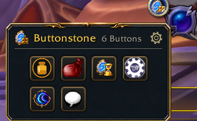
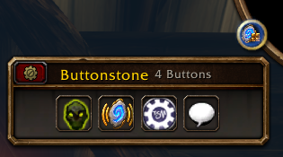
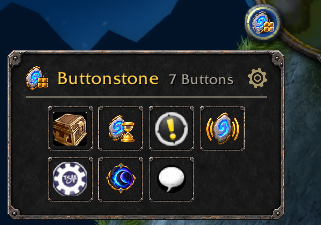

<p align="center"></p>

# Buttonstone – Azeroth Minimap Buttons

**All your minimap buttons. One stone.**

Buttonstone gathers the minimap buttons of your other addons into one button on the minimap rim. A click opens them in a small panel that wears your client's own look: Retail's gold, Classic's iron and stone, and WoW: Forever's bronze. It joins [Hourstone – Azeroth Hours](https://github.com/krebs3r/hourstone-azeroth-hours) and [Soundstone – Azeroth Audio](https://github.com/krebs3r/soundstone-azeroth-audio).

  

**Status:** 0.1.0 is out, released on 16 November 2026. The look was settled in the [mockup](docs/design/mockup.html), the plan is in [docs/PLAN.md](docs/PLAN.md).

## What it does

- One button on the minimap rim, dragged along it, or detached and placed anywhere.
- A panel with a grid of the gathered buttons, sorted by name, opening towards the side with more room and closing when the mouse leaves.
- Uniform slots in the client's look, so every addon's button matches; can be switched off.
- Every LibDBIcon button and the buttons addons make themselves; Blizzard's own buttons, map pins and protected frames stay where they are.
- An options window (`/bst`, right-click, or the panel's gear) with every setting and a checkbox for each button; a button you untick goes back to its own place at once, without `/reload`.
- With MinimapButtonButton or a similar addon active, Buttonstone leaves the buttons to it and says so.
- English and German.

## Clients

Retail (Midnight), Mists of Pandaria Classic, TBC Classic Anniversary, Classic Era and WoW: Forever, from one package. The look follows the client: Soundstone's gold sprites on Retail, its iron and stone on the Classic clients, Blizzard's own bronze frame on WoW: Forever.

## Installation

From [CurseForge](https://www.curseforge.com/wow/addons/buttonstone-azeroth-minimap-buttons), from [Wago](https://addons.wago.io/addons/buttonstone-azeroth-buttons) or from a [GitHub release](https://github.com/krebs3r/buttonstone-azeroth-buttons/releases). By hand, unpack it into the client's `Interface/AddOns` folder so that `Interface/AddOns/Buttonstone/Buttonstone_Mainline.toc` exists.

## Development

```bash
python -m venv .venv
.venv/Scripts/python -m pip install -r requirements-dev.txt
.venv/Scripts/python tests/run.py
.venv/Scripts/python -m unittest discover -s tests -p "test_*.py"
luacheck .
```

`tests/run.py` loads the addon's files in Lua 5.1 against a small WoW stand-in, once for each client; it does not replace a look in the game. `tools/install.ps1` copies the checkout into every installed client's AddOns folder as `Buttonstone` (pass `-WowPath` once).

## License

MIT, see [LICENSE](LICENSE). Blizzard names and game art belong to their owners; the project is independent and unofficial.
