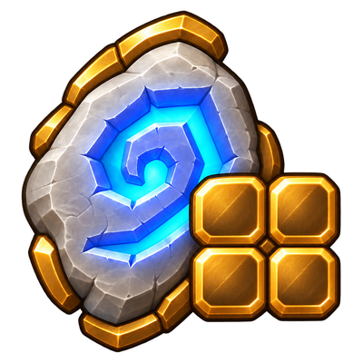

# Buttonstone – Azeroth Buttons

**All your minimap buttons. One stone.**

Buttonstone gathers the minimap buttons of your other addons into one button on the minimap rim. A click opens them in a small panel that wears your client's own look: Retail's gold, Classic's iron and stone, and WoW: Forever's bronze. It joins [Hourstone – Azeroth Hours](https://github.com/krebs3r/hourstone-azeroth-hours) and [Soundstone – Azeroth Audio](https://github.com/krebs3r/soundstone-azeroth-audio).

**Status: in development.** There is no release yet. The look is settled in the [mockup](docs/design/mockup.html), the plan in [docs/PLAN.md](docs/PLAN.md).

## Planned for 0.1

- One main button on the minimap rim, dragged along it, or detached and placed anywhere.
- A panel with a grid of the gathered buttons: columns, opening direction and size adjustable, closes when the mouse leaves.
- Uniform slots in the client's look, so every addon's button matches; can be switched off.
- Every LibDBIcon button and recognised buttons of their own; Blizzard's buttons only when you switch them on.
- Exclude any button with one click; it goes back to the minimap at once, without `/reload`.
- English and German.

## Clients

Retail (Midnight), Mists of Pandaria Classic, TBC Classic Anniversary, Classic Era and WoW: Forever, from one package.

## License

MIT, see [LICENSE](LICENSE). Blizzard names and game art belong to their owners; the project is independent and unofficial.
