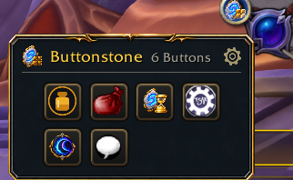
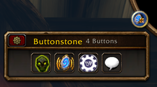
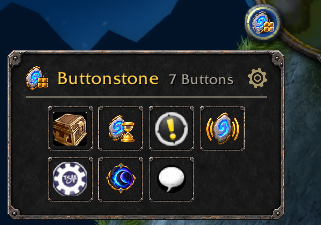

# Buttonstone – Azeroth Buttons

**All your minimap buttons. One stone.**

Buttonstone gathers the minimap buttons of your other addons into one button on the minimap rim. A click opens them in a small panel that wears your client's own look: Retail's gold, Classic's iron and stone, and WoW: Forever's bronze frame. Your minimap stays clear, and every button still works exactly as before.

  

## What it does

- **Gathers** every LibDBIcon button, also those made after you log in, and the buttons addons make themselves. Blizzard's own frames, map pins (HandyNotes, GatherMate and the like) and protected frames stay where they are.
- **One button on the minimap rim.** Drag it along the rim, on round and square minimaps, or detach it and place it anywhere on the screen.
- **A tidy panel.** A grid sorted by name, opening towards the side of the screen with more room. It closes shortly after the mouse leaves it, or with Escape.
- **Uniform slots.** Every button's icon sits in a slot in your client's look, so a dozen different round borders turn into one calm row. Switch it off to see each button as its addon made it.
- **Give a button back.** Untick it in the options and it returns to its own place at once, no `/reload` needed.
- **Your client's look, no setting needed.** Retail, Mists of Pandaria Classic, TBC Anniversary, Classic Era and WoW: Forever, from one download.

## Options

Right-click the Buttonstone button, click the gear in the panel, or type `/bst`:

- attach the button to the minimap, or place it freely;
- on Retail and WoW: Forever, show Buttonstone in Blizzard's addon list by the minimap clock;
- columns, direction, size, uniform slots, header, closing when the mouse leaves;
- every gathered button with a checkbox.

`/bst help` lists the commands: `list`, `detach`, `attach`, `reset`, `version`.

## Good to know

- **One collector at a time.** If MinimapButtonButton or a similar addon is active, Buttonstone leaves the buttons to it and tells you so. Turn one of the two off.
- **A button its addon hides stays hidden.** Turn it on in that addon and it appears in the panel.
- **Blizzard's own buttons** (tracking, calendar, mail) are not gathered yet; that comes in a later update.
- English and German.

From the same author: [Hourstone – Azeroth Hours](https://www.curseforge.com/wow/addons/hourstone-azeroth-hours), [Soundstone – Azeroth Audio](https://www.curseforge.com/wow/addons/soundstone-azeroth-audio) and [Umbra Unit Frames](https://www.curseforge.com/wow/addons/umbra-unit-frames). Source and issues: [GitHub](https://github.com/krebs3r/buttonstone-azeroth-buttons).

---

## Deutsch

**Alle Minimap-Buttons. Ein Stein.**

Buttonstone sammelt die Minimap-Buttons deiner anderen Addons in einem einzigen Button am Minimap-Rand. Ein Klick öffnet sie in einem kleinen Panel im Look deines Clients: Gold auf Retail, Eisen und Stein auf Classic, Bronze auf WoW: Forever. Die Minimap bleibt frei, und jeder Button funktioniert wie vorher.

- **Sammelt** alle LibDBIcon-Buttons, auch später erstellte, und die eigenen Buttons anderer Addons. Blizzards eigene Buttons, Karten-Pins und geschützte Frames bleiben, wo sie sind.
- **Ein Button am Minimap-Rand**, daran entlang verschiebbar, oder gelöst und frei platzierbar.
- **Ein aufgeräumtes Panel**, alphabetisch sortiert. Es klappt dorthin auf, wo mehr Platz ist, und schließt, sobald die Maus es verlässt, oder mit Escape.
- **Einheitliche Slots** im Look deines Clients, abschaltbar.
- **Buttons zurückgeben:** In den Optionen abhaken, und der Button kehrt sofort an seinen Platz zurück, ohne `/reload`.

Optionen per Rechtsklick auf den Buttonstone-Button, über das Zahnrad im Panel oder mit `/bst`. Ist MinimapButtonButton oder ein ähnliches Addon aktiv, überlässt Buttonstone ihm die Buttons und sagt dir Bescheid. Blizzards eigene Buttons kommen in einem späteren Update.
